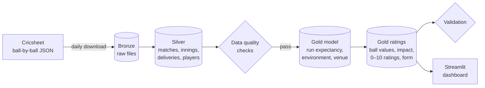

# Slogonomics

Sofascore-style 0–10 match ratings and form ratings for T20 cricketers, built as a medallion data pipeline (Bronze → Silver → Gold) on Databricks Free Edition with a Streamlit dashboard.

**Status:** V2.2 – dashboard features (records, head-to-heads, venues, consistency, full match history). V2.1 (better ratings) is tagged `v2.1`, V1 `v1.0`.

**Live dashboard:** https://slogonomics.streamlit.app/

## Architecture



A scheduled Databricks job (`docs/daily_job.md`) runs Bronze → Silver → checks → ratings → form → validation every morning on serverless compute, with failure emails.

## Repo layout

```
src/cricket_ratings/        Pipeline code shared by the notebooks and the tests
  config.py                 Table names in one place
  schema.py                 Spark schema for a Cricsheet JSON match file
  bronze.py                 Unzip and land raw files, once per version
  silver.py                 Parse into matches, innings, deliveries, players
  quality.py                Data quality checks that stop the pipeline on bad data
  gold_model.py             Run-expectancy table, environment and venue factors, per model version
  gold_ratings.py           Rating engine: ball values and player credits
  gold_scale.py             0–10 ratings (percentile within competition) and form
  validation.py             Checks that the ratings behave sensibly
  storage.py                All Delta table writes (MERGE / append / overwrite)
notebooks/
  01_week1_setup_and_cricsheet_check.py
  02_bronze_land.py         Week 2, step 1
  03_silver_build.py        Week 2, step 2
  04_silver_checks.py       Week 2, step 3
  05_gold_model.py          Week 3: fit the model tables and sanity-check them
  06_gold_ratings.py        Week 4: value every ball and credit players
  07_gold_scale_form.py     Week 5: 0–10 ratings, form and leaderboards
  08_validation.py          Week 6: run every validation check
tests/                      pytest suite on small hand-built matches
docs/daily_job.md           How to set up the scheduled Databricks job
app/                        Streamlit dashboard
  streamlit_app.py          Entry point and navigation
  data.py                   Loads the Gold tables once (cached 12 h), or demo files
  ui.py                     Rating colours, scorecard formatting, charts
  views/                    Form leaderboard, Player, Match, About pages
scripts/download_cricsheet.py  Local fallback download
```

## Tables

| Layer | Table | One row per |
| --- | --- | --- |
| Bronze | `bronze.match_files` | version of a raw Cricsheet file (append-only) |
| Silver | `silver.matches` | match |
| Silver | `silver.innings` | innings, with totals computed from deliveries |
| Silver | `silver.deliveries` | ball, including wides and no-balls |
| Silver | `silver.match_players` | player in a match |
| Silver | `silver.players` | player (Cricsheet Register ID) |
| Silver | `silver.venues` | ground (Cricsheet venue register): id, unique name, ESPNcricinfo id |
| Silver | `silver.venue_names` | every spelling of a ground used in match data → its venue id (spellings shared by two grounds are left out) |
| Gold | `gold.run_expectancy` | (model version, balls left, wickets down): expected runs to the end of the innings |
| Gold | `gold.environment_factors` | (model version, competition, year): how high-scoring that competition-season was |
| Gold | `gold.venue_factors` | (model version, venue): how high-scoring the ground is within its competition |
| Gold | `gold.ball_values` | (model version, ball): state before/after, ball cost, wicket cost, runs added |
| Gold | `gold.player_match_impact` | (model version, match, player): batting, bowling and fielding impact in runs, plus counting stats |
| Gold | `gold.player_match_ratings` | (model version, match, player): 0–10 rating, percentile within competition, impact and stats |
| Gold | `gold.player_form` | (model version, scope, player): form rating, matches counted, leaderboard rank; scope is "All" or a competition |
| Gold | `gold.matchups` | (model version, competition, batter, bowler): balls, runs, dismissals credited to the bowler, dots, 4s, 6s, and runs vs par |
| Gold | `gold.par_rates` | (model version, over, wickets-down band): typical bowler's runs and wickets per legal ball |
| Gold | `gold.model_versions` | model version: when and how it was fitted |
| Ops | `ops.ingest_log` | file processed at each stage (landed, parsed, quarantined) |
| Ops | `ops.validation_results` | validation check result per model version and run |
| Ops | `ops.dq_results` | data quality check result per run |

Design choices:
- **Idempotent:** re-running any step adds nothing. Bronze is keyed on file name + SHA-256 hash; Silver replaces a match's rows rather than appending.
- **Incremental:** Silver only processes files (or new versions of files) it hasn't seen.
- **Quality gate:** error-level checks (duplicates, run arithmetic, unresolved player IDs, target reconciliation) fail the run before Gold is built.
- **Legal balls:** `legal_ball_no` counts deliveries that aren't wides or no-balls, which is what run expectancy needs.

## The run-expectancy model

`RE(b, w)` is the average number of runs a side scores from a point in its innings to the end, with `b` legal balls left and `w` wickets down. Week 4 values each ball by how much it changes this number.

- **Fitted on first innings only**, from full-length completed matches. A chase stops when the target is reached, which would cut "runs to the end" short. V1 uses the same table for both innings.
- **Each innings counts once per state**, the first time it reaches it, so a wide doesn't double-count a state.
- **Smoothed with a curve** (V2.1): for each wickets-down level, a Duckworth–Lewis-style curve `Z0 · (1 − e^(−k·b))` is fitted to the cell averages, and each cell blends its own average with the curve, weighted by how many innings reached it (`(n·mean + 50·curve) / (n + 50)`). Rare states (5 down with 15 overs left) follow the curve instead of noise. The table is then made monotone: more balls never means fewer runs, and more wickets never means more. V1 pooled neighbouring cells with straight lines, which let a few dismissals cost almost 40 runs.
- **Fitted on 2019 onwards** for modern batting patterns.
- **Scoring environment:** the IPL now averages 190+ in the first innings while T20Is (mostly associate nations since 2019) average about 150. One table alone would overrate every IPL batter, so expected runs = `RE(b, w) × environment factor × venue factor`. The environment factor is a competition-year's average first-innings total ÷ RE(120 balls, 0 down), so a side's expected total at the start of an innings is exactly its competition-year's average. It covers every season, so older matches are rated against their own era, and small seasons are pulled towards their own competition's level rather than the global average.
- **Venue factor** is measured against what each match's competition and year predict, so a ground isn't "high-scoring" just for hosting the IPL. Both factors are shrunk towards 1.0 when they rest on few matches: `1 + m / (m + k) × (raw − 1)`, with k = 5 (environment) and 10 (venue).

## The rating engine

Every ball is valued by how much it changed the batting side's expected runs: `runs added = runs + E(after) − E(before)`, split into the **ball cost** (using up a legal ball) and the **wicket cost** (the drop when a batter is out).

| Player | Credit |
| --- | --- |
| Striker | runs off the bat + ball cost |
| Batter who is out | wicket cost |
| Bowler | −(runs off the bat + wides + no-balls) − ball cost + bowler share of the wicket |
| Fielders | fielder share of the wicket, split between the fielders named |

Wicket shares (starting values): bowled, lbw, hit wicket, caught and bowled 100% bowler; caught 80% bowler / 20% catcher; stumped 70% / 30% keeper; run out 100% to the fielders. Byes and leg-byes aren't charged to the bowler. Shortened matches use the reduced overs, **per innings** (V2.1): a first innings cut short by rain is valued against the length it actually had, not the full 20 overs, which in V1 inflated rain-hit first innings by 30 runs. Byes are charged to the wicketkeeper (V2.1): the keeper is inferred as the fielding player with the most career stumpings. Super overs and no-results aren't rated. T20Is are split into full-member matches and those involving associates, which score very differently.

## Ratings and form

- **Role-relative ranking** (V2.1): impact is first divided by the match's scoring level (environment × venue), then each part is ranked against its own kind within the **same competition** (IPL, T20I full members, T20I other):
  - **batting** against innings that began at the same **stage**: opener, top order (60+ balls left), middle order (30–60), finisher (under 30). A finisher's 20 off 6 is compared with other finishers, not with openers who had 15 overs to build;
  - **bowling** (an over or more) against other bowling performances;
  - each rank becomes a standard score; 0 is a typical performance of that kind, so an all-rounder's two scores are **added** (V2.1.1): an average spell leaves the batting score unchanged, a poor one subtracts (Maxwell's 145* with two expensive overs: 9.0 when V2.1 divided the sum by √2, which penalised even an average spell), and the part with fewer balls counts `n / (n + 24)` of its score, so a bowler's 3-ball tail-end innings barely moves his rating (without this, players who did both crowded the 9+ and 4-or-less ratings); fielding plus any part-over of bowling is added in the same units.
- **0–10 rating:** the combined score's percentile within the competition is mapped onto anchors, interpolating between them: 1st → 3.0, 25th → 5.8, 50th → 6.5, 90th → 8.0, 99th → 9.3, best ever → 10.0. Ranking within the competition stops lopsided associate matches from taking most of the top ratings.
- **Involvement:** players are rated only if they faced 5 balls, bowled an over, were dismissed, or took part in a dismissal; others show "–".
- **Form:** weighted average of the last 10 ratings, each match counting half as much every 5 matches back; needs 3 rated matches. Leaderboards rank active players (played in the last 12 months) with 5+ rated matches, overall and per competition.

## Validation

`08_validation` checks one model version and fails if any check fails:

| Check | Target |
| --- | --- |
| First-innings runs added per competition since 2019 (calibration) | within ±3 runs |
| Rain-affected first innings: runs added | within ±5 runs |
| Dismissals costing over 25 runs | fewer than 1 in 10,000 |
| Median rating per competition | 6.2–6.8 |
| Ratings at 9.3+ per competition | 0.5–2% |
| Share of 9+ ratings: highest season minus lowest (seasons with 1,000+ ratings) | at most 2.5 points |
| 9+ ratings driven mainly by bowling | within 5 points of bowling's fair share (performances led by bowling ÷ all; a performance with both counts once, by the part with more balls) |
| Players who batted and bowled: share of 9+ (or 4 or less) ÷ share of all ratings | at most 1.3 |
| Batting stages: widest / narrowest rating spread | at most 1.3 |
| Batting stages: highest / lowest share of 9+, and of 4 or less | at most 2 |
| Quick cameos (15+ off ≤8) vs 35–45 off 26–32: average rating | cameo at least as high |
| Official player of the match in the top 3 rated | at least 70% of matches |
| Famous performances (chosen independently of the model) rating 9+ | at least 80% |

It also compares player-of-the-match awards the model disagrees with against those it agrees with, by role and by winning or losing side.

### Results (model v3 = V2.1, 16 Nov 2026)

All 26 checks pass.

| Check | V1 (`v2`) | V2.1 (`v3`) |
| --- | --- | --- |
| Calibration: IPL / T20I full members / T20I other | +0.22 / +1.35 / +1.57 | +0.13 / +0.31 / +0.61 |
| Rain-affected first innings, avg runs added | +30.5 | −0.9 |
| Dismissals costing over 25 runs | 8 of 61k (worst −38.5) | 1 of 61k (worst −25.4) |
| Share of 9+ ratings, lowest to highest season (IPL) | rising to 4.8–5.3% | 2.2–4.1% |
| Rating spread by stage: opener / top / middle / finisher | 1.56 / 1.35 / 0.85 / 0.62 | 1.46 / 1.47 / 1.44 / 1.57 |
| Quick cameo vs 35–45 off 26–32, average rating | cameo lower | 7.66 vs 7.50 |
| 9+ ratings mainly bowling, vs bowling's fair share | 34–37% (fair share about 48%) | 45–47% (fair share 48–49%) |
| Batted and bowled: share of 9+ ÷ share of ratings | – | 1.16–1.20 |
| Player of the match in our top 3 / top-rated | 81.6% / 51.7% | 79.8% / 48.3% |
| Famous performances rating 9+ | 9 of 10 (Yuvraj 8.8) | 10 of 10 (Yuvraj 10, Maxwell 9.9) |

- **Finishers now use the whole scale.** In V1 a finisher could barely go below 5 or above 7.5, so a late 2 off 5 rated 6.0 while an opener's failure rated about 3. V2.1 ranks each innings against innings that started at the same point.
- **Cameos count.** Yuvraj Singh's 58 off 16 (six sixes) moves from 8.8 to 10, and short, fast innings now average slightly above steady 40s.
- **Bowlers get their fair share.** V1 under-rated bowling (34–37% of 9+ ratings against a fair share near 48%). An early V2.1 run over-corrected: adding an all-rounder's two parts at full weight let bowlers who also batted at the tail crowd both ends of the scale. Weighting the smaller part (`n / (n + 24)`) fixed it.
- **All-rounders:** Maxwell's 145* with two expensive overs is 9.9: the best innings, docked a little for the bowling. Dividing the parts by √2, as first tried, gave 9.0.
- **Trade-off:** player-of-the-match agreement dips slightly (still well above the 70% target): awards favour long innings by winning batters.
- The median and the 9.3+ share are identical across competitions by design (ratings are percentiles within each competition), so they confirm the mapping rather than the model.

### Known limitations, from validation

- **Ratings value runs above expectation, not *when* they swing a match.** A win-probability model would.
- **Ratings ignore the result.** Where the official player of the match isn't in our top 3, the award winner is nearly always on the winning side; our top-rated player often isn't.
- **Bowlers who didn't bat reach 9+ more often than batters who didn't bowl** (3.7% vs 2.9% in full-member T20Is, before the final weighting). Likely a selection effect: when bowlers rip through a side, their team chases easily and they never bat.
- **Opposition strength isn't modelled.** Ranking within competition removes most of the effect of lopsided associate matches, but a big score against a weak attack still counts the same as against a strong one.
- **The keeper is inferred** from career stumpings, so a stand-in keeper may not be charged the byes.

## Dashboard

A seven-page Streamlit app (`app/`), deployed on Streamlit Community Cloud with main file `app/streamlit_app.py`:

| Page | Shows |
| --- | --- |
| Form leaderboard | Top players by form, overall or per competition; click a row to open the player |
| Player | Nationality and every team played for, current form, consistency (median, spread, good and off days), last 20 ratings as a colour-banded chart, where the impact comes from, best grounds, most-faced bowlers and batters, and the full match history with filters (competition, year, role) and pages; click a match to open it |
| Match | Score, result, and both teams' players rated with their batting, bowling (with par: the wickets/runs a typical bowler gets from the same overs with the same wickets down, e.g. `1/34 (4.0) · par 1.2/31`) and fielding lines; the official player of the match is starred |
| Records | Best single performances, most 9+ ratings, best career averages, best seasons and the most consistent players, overall or per competition |
| Head-to-head | Any batter against any bowler: runs, balls, dismissals, strike rate, dot balls and runs vs par, per competition |
| Venues | Every ground (spellings merged with Cricsheet's venue register): average scores, how often the side batting first wins, who rates best there compared with elsewhere, best performances and recent matches |
| About | Method, rating bands, model version, latest data, live validation results and known limitations |

Each Gold table is read once from the SQL warehouse and cached for 12 hours, so pages respond instantly and the warehouse is barely used. Player and match pages have shareable links (`?player=…`, `?match=…`).

**Secrets** (Streamlit app settings): see `.streamlit/secrets.toml.example`; add `catalog` and the `[app]` section to the week 1 secrets.

**Run locally without Databricks** (demo data with the same shape as the real tables):

```bash
pip install -r requirements.txt
python tests/app_demo.py demo_data
CRICKET_RATINGS_DATA_DIR=demo_data streamlit run app/streamlit_app.py
```

## Daily updates

Every morning a Databricks job downloads Cricsheet's last-7-days men's zip, lands new files and corrected versions in Bronze, and rebuilds Silver and Gold. The zip holds every format and league, so Silver keeps only men's T20 internationals and the IPL (others are logged as out of scope). Set-up: [`docs/daily_job.md`](docs/daily_job.md).

## What's next

- **Win probability** instead of run expectancy, to value match-turning moments and chase pressure.
- **Opposition strength:** credit runs against strong attacks more than against weak ones.
- **More competitions:** women's T20Is and the WPL, BBL, PSL and others, each backfilled and added to the scope.
- **ODIs and Tests**, each with its own model.

## Running the pipeline by hand

For a backfill or a new model version, pull the latest code into your Git folder, then run on serverless compute, in order (the daily job runs 02–04 and 06–08):

1. `notebooks/02_bronze_land.py`
2. `notebooks/03_silver_build.py`
3. `notebooks/04_silver_checks.py`
4. `notebooks/05_gold_model.py` (week 3)
5. `notebooks/06_gold_ratings.py` (week 4)
6. `notebooks/07_gold_scale_form.py` (week 5)
7. `notebooks/08_validation.py` (week 6)

## Tests

```bash
pip install -r requirements-dev.txt   # needs Java 17+
pytest -q tests
```

The tests cover the dashboard (every page rendering on demo data, filters, links between pages, a clear error when data is missing, scorecard formatting), every validation check passing on good data and failing on bad, the 0–10 mapping and form (anchors, interpolation, within-competition ranking, involvement, recency weights, leaderboard eligibility), role-relative ranking (finishers and openers sharing the scale, a quick cameo beating a middling long innings, bowling ranked against bowling, all-rounders combining both), the rating engine against hand-worked credits for a full innings (wides, no-balls, leg-byes, a catch, a substitute's run out, scaling), rain-shortened innings, batting stages and keeper byes, the curve-fitted run-expectancy table (recovering a known curve, sparse cells, monotonicity, the V1 costly-dismissal regression), the first-time-in-state observations, versioned model writes, legal-ball counting with wides and no-balls, wickets and substitute fielders, no-result and super-over matches, quarantining bad files, idempotent re-runs, revised files, and the quality checks catching broken rows. Delta-only writes (in `storage.py`) are swapped for plain-Spark equivalents in tests.

## Data and attribution

Ball-by-ball data from Cricsheet (cricsheet.org), used under the Open Data Commons Attribution License.
